    This is my journey of starting JavaScript from basic to building a huge project
    in this journey i am going to do all thing step by step 
    here is my roadmap 
     javascript   --------------------------------
         |                                        |
        JSON                                      |
         |                                        |
     TypeScript                                   |--------->> JavaScript
         |                                        |
        Vue.js                                    | 
         |                                        |
       Jquery ------------------------------------                      
         |
         |
       React.js------------------------------------
         |                                         |
        Node.js                                    |------>> FRONTEND WITH CSS AND HTML 
         |                                         |
      Angular  ------------------------------------
         | 
         |                                        
       Node.js ------------------------------------
         |                                         |
    Express.js                                     |
         |                                         |--------->>BACKEND 
        PHP                                        |
         |                                         |
       Django--------------------------------------
         |
      MongoDB--------------------------------------
         |                                         |                         
        Redis                                      |----------->> DATABASE
         |                                         |
        SQL ---------------------------------------
         |
        E N D          
 
 

    DATATYPE CHART
    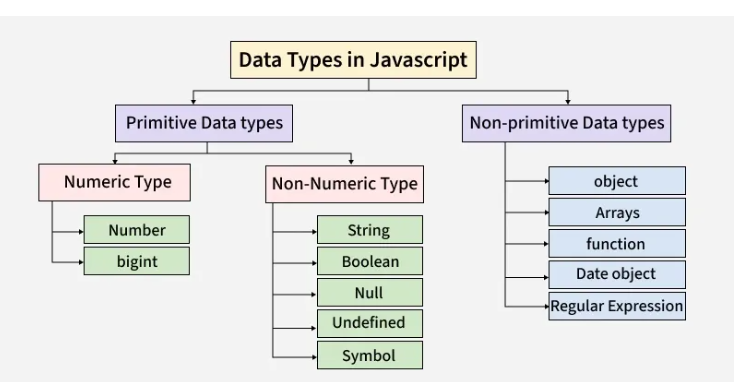

    In above image we learn the Type of DataType in Js

 
   
    # For string we use this to type inside string 
    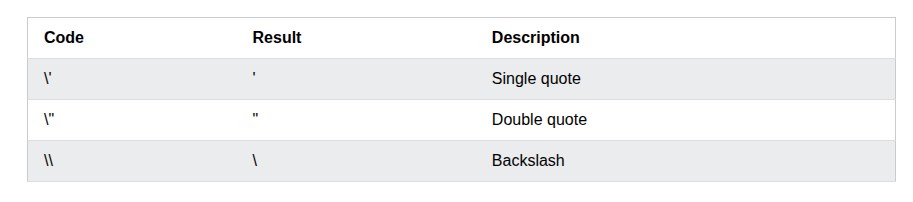
    here

 
#for formating text

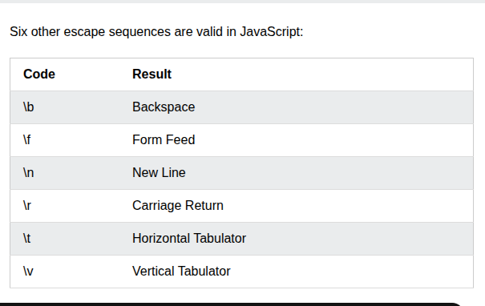

 
#String Method

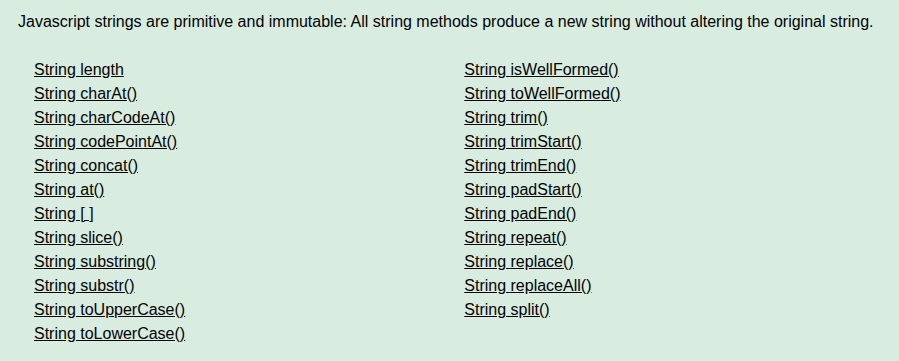
 

#Left Column

• length:           String character count.
• charAt():         Character at index.
• charCodeAt():     Character's Unicode number.
• codePointAt():    Full Unicode code.
• concat():         Joins strings together.
• at():             Index supports negatives.
• []:               Array-like character access.
• slice():          Extracts string section.
• substring():      Extracts between indices.
• substr():         Extracts by length.
• toUpperCase():    Converts to uppercase.
• toLowerCase():    Converts to lowercase.
 

#Right Column

• isWellFormed():       Checks Unicode validity.
• toWellFormed():       Fixes broken Unicode.
• trim():               Removes surrounding whitespace.
• trimStart():          Removes leading whitespace.
• trimEnd():            Removes trailing whitespace.
• padStart():           Pads string beginning.
• padEnd():             Pads string end.
• repeat():             Duplicates string repeatedly.
• replace():            Replaces first match.
• replaceAll():         Replaces all matches.
• split():              Converts to array.

 
#over all overview of String

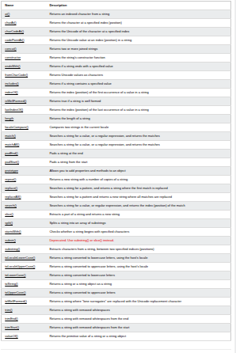

 

#why to use function 

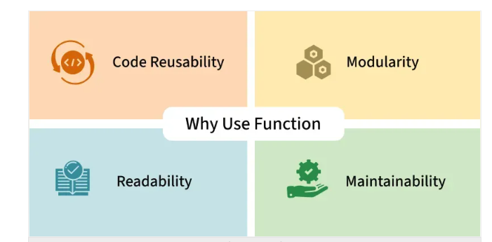

 
#structure of function 

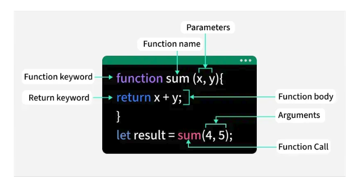

 
#function expression and Declaration

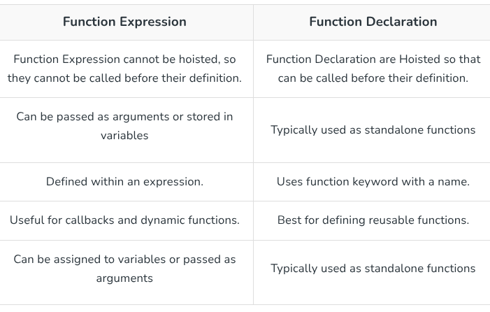

<h1>important that function callback(foreach) is <ins>higher order function (hof)</ins> which take parameter as other funct or return value<h1/> 
 
#object  between and new object 
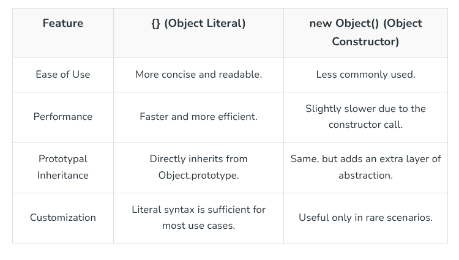

 
-Difference between Map and Object
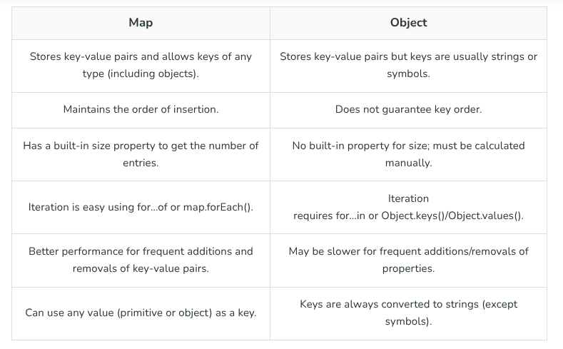
 
<h1>OOP</h1>
<h2>CHARACTERISTIC OF OOP</h2>
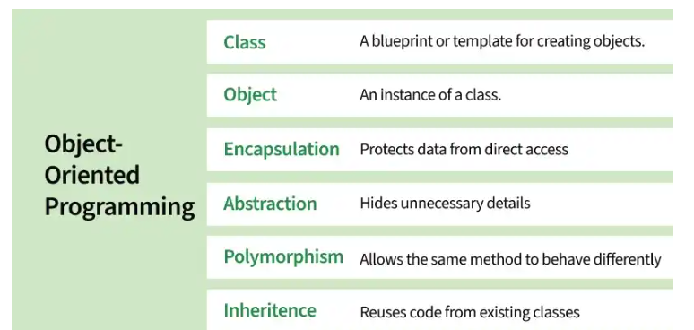
 
<h2>Class Object example</h2>
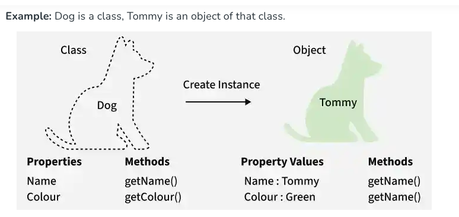
 
<h1>Pillar of OOP</h1>
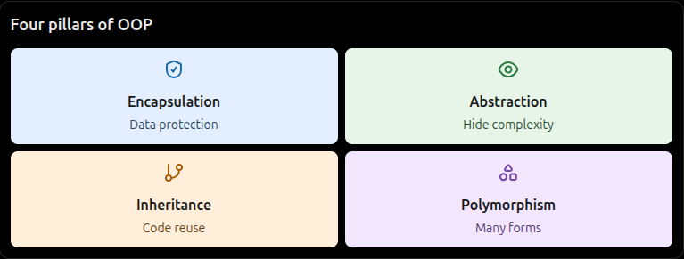
 
<h2>Abstraction</h2>
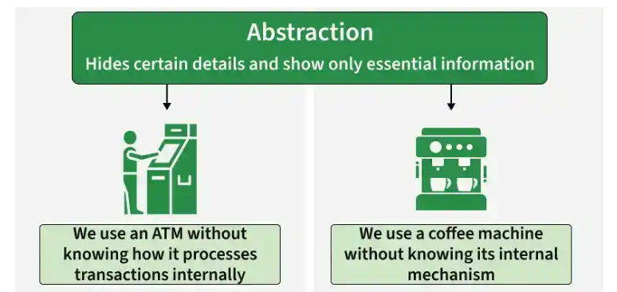

 
<h2>Encapsulation</h2>
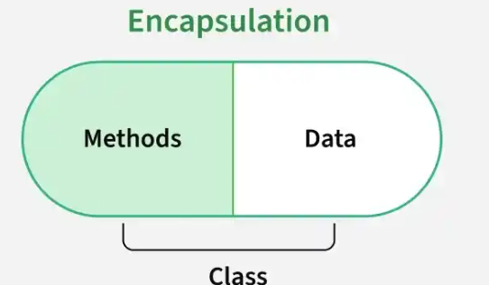
 
<h2>Inheritance </h2>
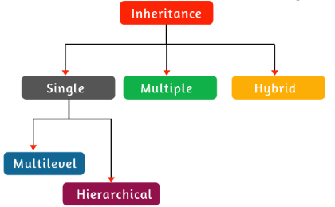
 
<h2>Polymorphism</h2>
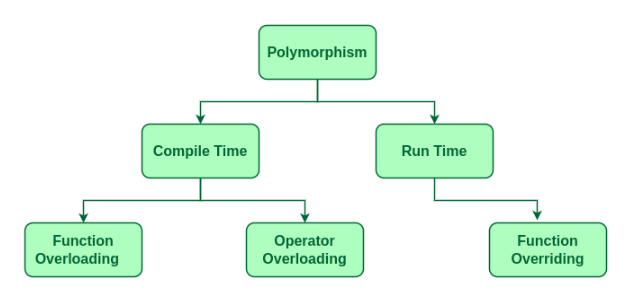
 
<h1>DOM</h1>
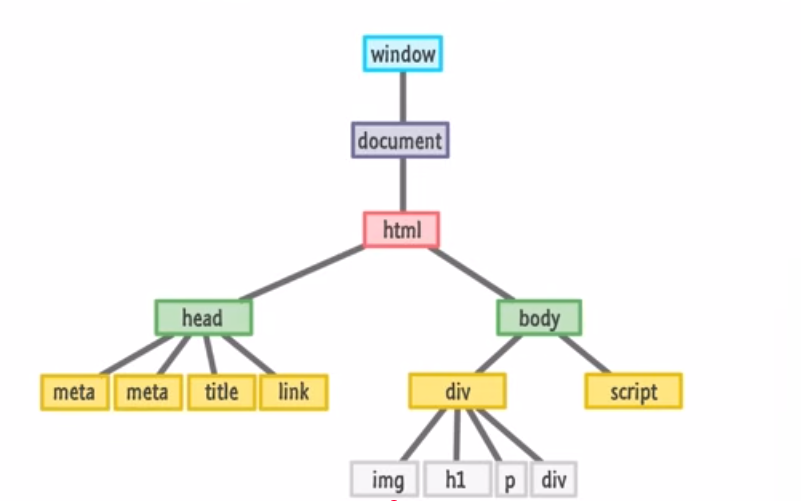

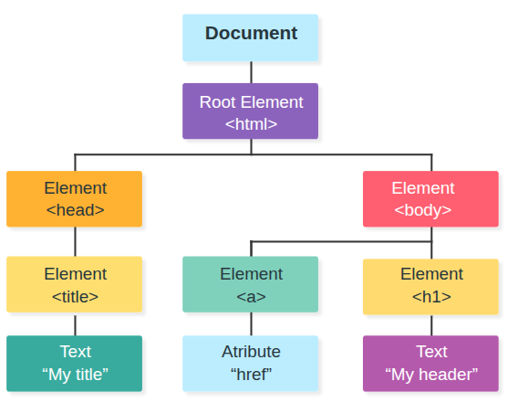

